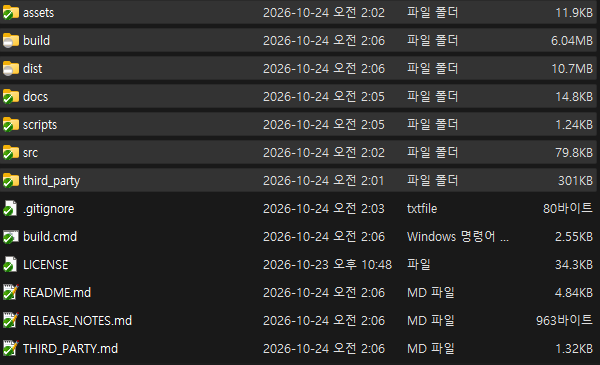
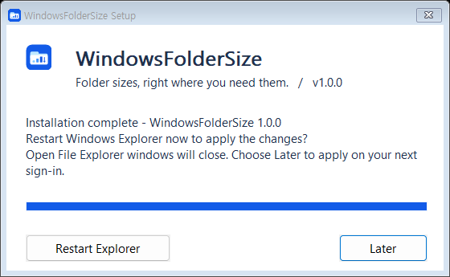

<p align="center"></p>
<h1 align="center">WindowsFolderSize</h1>
<p align="center">Folder sizes, right where you need them.</p>
<p align="center">
  <a href="https://github.com/MDJ0126/WindowsFolderSize/releases/latest"></a>
  
  <a href="LICENSE"></a>
</p>

A small native extension that adds folder sizes to **File Explorer's existing Size column**. No separate disk browser, no Windhawk, no Everything dependency.

## In File Explorer

Folder totals appear directly in the existing **Size** column alongside normal file sizes.

<p align="center"></p>

## Download

> **Download temporarily paused:** Microsoft Defender flagged the 1.0.0 installer. The detection is under investigation; a false positive has not been established. Do not disable antivirus protection or add an exclusion.

**[Download the latest installer](https://github.com/MDJ0126/WindowsFolderSize/releases/latest)** and run `WindowsFolderSizeSetup-1.0.0-x64.exe`.

1. Run the installer and approve extension registration when Windows asks.
2. Follow the progress inside the setup window.
3. Choose **Restart Explorer** to apply immediately, or **Later** to apply at your next sign-in. Restarting Explorer closes its open windows.
4. Open a local folder in **Details** view with the **Size** column enabled.

The application starts automatically when you sign in. There is no main window to keep open.

<p align="center"></p>

## What you get

| Feature | Behavior |
| --- | --- |
| Integrated sizes | Folder totals appear beside ordinary file sizes. |
| Animated progress | `.37%` → `..37%` → `...37%` while calculating. |
| Responsive scheduling | A single worker shares time between requested folders. |
| Stable updates | Completed totals stay visible during background refreshes. |
| Native setup | Installation progress, results and optional Explorer restart in one window. |

## Good to know

- **Windows 11 x64 is the tested platform.** Other Windows versions and ARM64 are not validated.
- Progress measures completed shares of directory traversal, **not elapsed time or a byte percentage**. A tiny folder may finish before an intermediate percentage can be displayed. A flat directory can remain at 0% during enumeration.
- Local drive-letter paths are supported. Network/UNC paths are not currently scanned; directory junctions and directory symlinks are skipped to prevent recursive loops and double counting.
- Folder sizes count logical file bytes, not allocated disk space. Access-denied folders may show an unavailable result.
- Windows updates can change Explorer internals. The extension checks the system DLL identity and refuses mismatched hook addresses. First preparation, and preparation after a Windows change, needs access to Microsoft's public symbol server.
- The extension uses one Explorer overlay-handler registration, but draws no icon overlay. Explorer itself loads the COM extension; the broker does not inject into remote processes.
- The installer is unsigned. Source and SHA-256 checksums are provided with the release.

## Installation and removal

Files are installed to `%LOCALAPPDATA%\WindowsFolderSize`. The background startup entry belongs to the current user; Explorer extension registration requires administrator approval.

Remove **WindowsFolderSize** from **Settings → Apps → Installed apps**, or run the installed setup with `--uninstall`. Files still loaded by Explorer are cleaned up at the next sign-in.

If you used the earlier private **FolderSize** prototype, uninstall it before installing this public version.

## Build from source

Requirements: Visual Studio 2022 with **Desktop development with C++**, a Windows SDK, and the SDK's **Debugging Tools for Windows** component. The current script uses the Visual Studio 2022 Community installation path; adjust it for another edition.

```bat
build.cmd
```

The installer is written to `dist\WindowsFolderSizeSetup.exe`. Version 1.0.0 is embedded in the executable resources. The project uses the static C++ runtime.

The source includes tests for resumable scans, progress formatting through the native shell property APIs, change detection and installer controls. `scripts\test.cmd` runs them in a separate test namespace; it does not restart Explorer or install the application.

## How it works

A native background broker enumerates file metadata and watches for changes. An Explorer COM extension retrieves cached totals and formats pending scan values in the standard Size column. Microsoft public symbols resolve the Explorer hooks for the installed Windows build.

## License and credits

**GPL-3.0-or-later.** See [LICENSE](LICENSE) and [THIRD_PARTY.md](THIRD_PARTY.md).

Thanks to m417z for the documented Explorer hook ABI/cache behavior and to the MinHook contributors. The folder-and-chart icon in `assets/` was created for this project and is included under the project license.
